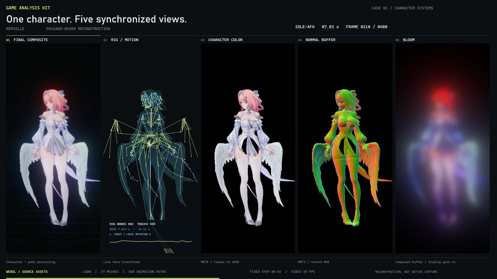

# Game Rebuild Kit

[English](README.md) | [简体中文](README.zh-CN.md) | **日本語**

**ビジョン：あらゆるゲームをワンクリックで分析し、実装全体を再構築する。**

- **分析：** ゲームの挙動を支えるアルゴリズム、データ関係、実行フローを追跡する。
- **再構築：** 得られた根拠に基づき、ロジック、アニメーション、物理、レンダリングなどのゲームシステムを再現する。

このリリースに含まれるのは、エージェント用スキルと実例です。あらゆるゲームに対応するワンクリックでの自動化と完全な再構築は、引き続きプロジェクトの目標です。

[インタラクティブプレビューを開く（ログイン不要）](https://remielle-motion-study.pages.dev/)

[1080p動画を見る](media/character-debug-1080p.mp4)

16秒、1920 x 1080、30 fps、無音。各ビューは同じアニメーション状態とカメラを共有します。バッファビューには再構築したレンダラーの実出力を使用し、表示変換をラベルで示しています。

## 事例：キャラクターのアニメーションとレンダリング

この例では、キャラクターのリソースがアニメーション、二次モーション、レンダリングへどうつながるかを追跡します。動画では次を確認できます：

- **最終合成：** キャラクターのシェーディングとポストプロセス。
- **リグ／モーション：** 各フレームのリグ変換、アニメーション時間、回転トレース。
- **キャラクターカラー：** 最初のキャラクターカラーアタッチメント（MRT0）。
- **ノーマルバッファ：** ノーマルアタッチメントに格納されたRGB値（MRT3）。
- **ブルーム：** 合成済みブルームバッファを2倍ゲインで表示。

これはパッケージベースの再構築であり、パラメータをフィッティングしています。ネイティブ版ゲームとの同等性を検証したものではありません。

## クイックスタート

1. エージェントに [SKILL.md](skills/game-analysis/SKILL.md) を読ませます。
2. ゲームのビルドまたはサンプル、知りたい問い、必要な結果を伝えます。

> game-analysis を使って、このゲームの挙動を調査してください。問いを明確にし、必要な証拠を最小限の手順で集めてください。何が確認でき、どのような証拠があれば結論が変わるかを説明してください。

再利用する場合は、`skills/game-analysis/` ディレクトリ全体を、エージェントがサポートするスキルディレクトリへコピーします。ツールの選定、チェックの設計、結果の報告時には [フィールドガイド](skills/game-analysis/references/field-guide.md) を読み込みます。

なお、SKILL.md とフィールドガイドは現在、英語で整備されています。

## 範囲と要件

| 項目 | 範囲 |
|---|---|
| 対象 | ゲームロジック、アニメーション、物理、レンダリング、再構築結果の検証 |
| 要件 | スキル自体にランタイム依存なし。分析ツールは対象と問いに依存 |
| 含まれるもの | 分析手順、フィールドガイド、代表的なメディア |
| 含まれないもの | 抽出済みゲームアセット、フォーマットデコーダー、ビューワーランタイム、自動再構築システム |
| 現在の証拠 | 1件の Android / Unity 調査から整理。ゲームをまたいだ有用性は今後評価が必要 |

サンプルとタスク固有のスクリプトは、ローカルのケースディレクトリに置きます。必要に応じて既存ツールを選び、繰り返し利用するだけの理由がある場合に限り共有コードを追加します。

## 方法

1. 各結論の適用範囲を定義する。
2. 入力を計算と下流での利用を経て結果まで追跡する。
3. 根拠のある挙動仕様を記述し、不明点を明示する。
4. 独立した参照と照合する。
5. 観測、推論、フィッティング値を区別する。
6. 不確実性を解消するチェックを選び、依頼された目標を満たしたら停止する。

ゲーム固有の焦点は、リソース参照、時間経過に伴う状態、計算結果の下流での利用です。

## 帰属表示

[leanrea](https://github.com/aicodeking/leanrea) の直接CLI方式に着想を得ており、コミット `09ba4aa` を確認しています。上流のベンチマーク結果は、このリポジトリの性能を示すものではありません。

スキル本文は [MIT ライセンス](LICENSE) です。メディアに表示される第三者のゲームコンテンツと外部ツールには、それぞれの権利およびライセンスが適用されます。
