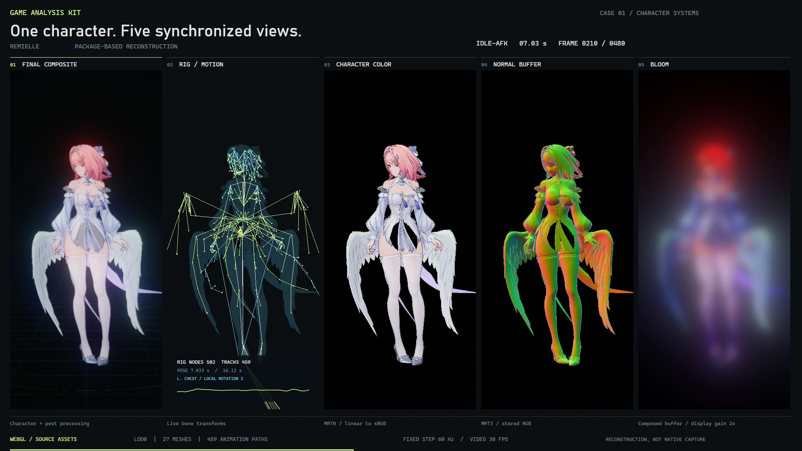

# Game Rebuild Kit

**English** | [简体中文](README.zh-CN.md) | [日本語](README.ja.md)

**Vision: analyze any game in one click and reconstruct its full implementation.**

- **Analyze:** trace the algorithms, data relationships and execution flow behind game behavior.
- **Reconstruct:** reproduce game systems from recovered evidence, covering logic, animation, physics and rendering.

This release provides an agent skill and a worked example. Universal one-click automation and complete reconstruction remain project goals.

[Open the interactive preview (no sign-in required)](https://remielle-motion-study.pages.dev/)

[Watch the 1080p video](media/character-debug-1080p.mp4)

16 seconds, 1920 x 1080, 30 fps, silent. The views share one animation state and camera. Buffer views use actual outputs from the reconstructed renderer; display transforms are labeled.

## What you can get

Use the skill to guide an agent toward the deliverable you request. Depending on the available target resources, tools and evidence, the result can include:

| Deliverable | What you can inspect or use |
|---|---|
| Evidence-backed analysis | Resource and behavior relationships, algorithms, parameter origins and unresolved questions, with evidence locators and reproducible checks |
| Interactive reconstruction | A runnable HTML/viewer with camera controls, material and post-processing output, and supported character/outfit selection; animation or secondary motion when requested and supported by recovered data |
| Live render-pipeline inspector | A stage list generated from actual renderer execution, a slider or selector for stage outputs, and views of color, depth, normals or post-processing buffers where available; inputs, outputs, dimensions, formats and relevant draw state are exposed alongside them |
| Verified quality and variant coverage | An audit of selected meshes, skinning, textures and required passes, plus matched comparisons that separate asset detail, anti-aliasing, alpha composition and output resolution |
| Portable delivery | A package with declared runtime dependencies, launch instructions, package-integrity checks and separate startup validation using only the delivered contents |

For a rendering task, this can mean opening a viewer, moving the camera, switching supported variants and inspecting intermediate buffers through to the final image. The inspector describes the reconstructed renderer's execution; cached inputs and display conversions are labeled. Static poses, animation support and recovered original-game behavior are reported separately.

These are task-specific outputs the agent builds and validates, not a viewer runtime bundled with this repository. Select the outputs you need; a focused analysis does not require every feature. See the [rendering and viewer guidance](skills/game-analysis/references/field-guide.md#diagnose-the-final-image).

## Case: character animation and rendering

The example traces character resources into animation, secondary motion and rendering. The recording shows:

- **Final composite:** character shading and post-processing.
- **Rig / motion:** live rig transforms, animation time and a rotation trace.
- **Character color:** the first character color attachment (MRT0).
- **Normal buffer:** stored RGB values from the normal attachment (MRT3).
- **Bloom:** the composed bloom buffer, displayed at 2x gain.

This is a package-based reconstruction with fitted parameters, not verified native-game equivalence.

## Quick start

1. Ask your agent to read [SKILL.md](skills/game-analysis/SKILL.md).
2. Provide the game build or sample, the question, and the result you need.

> Use game-analysis to investigate this game behavior. State the question, choose the smallest useful evidence path, and explain what is established and what could change the conclusion.

For a viewer deliverable:

> Build an interactive character HTML viewer from this sample, with a live render-stage inspector and a portable package. Verify the selected asset quality, expose actual render/output dimensions, and report supported interactions and unresolved differences from the original game.

For reuse, copy the entire `skills/game-analysis/` directory into a skill directory supported by your agent. Load the [field guide](skills/game-analysis/references/field-guide.md) when selecting tools, designing checks or reporting results.

The skill and field guide are maintained in English.

## Scope and requirements

| Item | Scope |
|---|---|
| Focus | Game logic, animation, physics, rendering and reconstruction audits |
| Requirements | No runtime dependencies for the skill itself; analysis tools depend on the target and question |
| Included | Analysis instructions, a field guide and representative media |
| Not included | Extracted game assets, format decoders, a viewer runtime or an automated reconstruction system |
| Current evidence | Distilled from Android / Unity case work and HTML follow-ups; effectiveness across games needs further evaluation |

Keep samples and task-specific scripts in local case directories. Select existing tools as needed; add shared code only when repeated use justifies it.

## Method

1. Define the scope of each claim.
2. Trace inputs through computation and downstream use to the result.
3. Describe the supported behavioral contract; mark unknowns.
4. Validate against an independent reference.
5. Distinguish observations, deductions and fitted values.
6. Choose checks that resolve uncertainty; stop when the requested goal is met.

The game-specific focus is on **resource references, state over time, and downstream use of computed results**.

## Attribution

Inspired by the direct-CLI approach in [leanrea](https://github.com/aicodeking/leanrea), reviewed at commit `09ba4aa`. Upstream benchmark results are not performance claims for this repository.

The skill text is [MIT licensed](LICENSE). Third-party game content shown in the media and external tools retain their respective rights and licenses.
