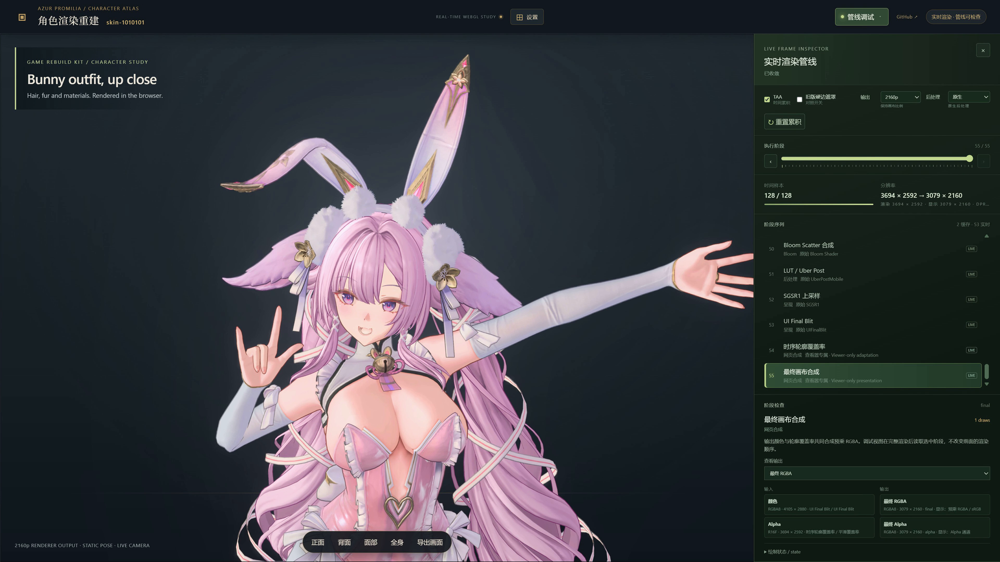
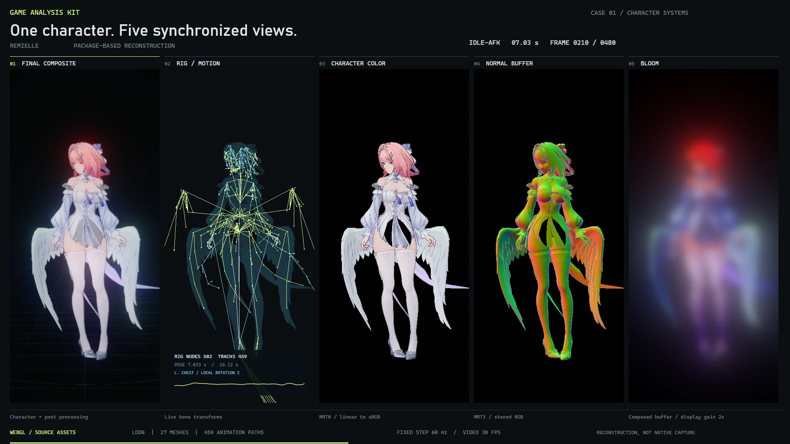

# Game Rebuild Kit

[English](README.md) | **简体中文** | [日本語](README.ja.md)

**愿景：一键分析任何游戏，并还原其完整实现。**

- **分析：** 追踪游戏行为背后的算法、数据关系与执行流程。
- **还原：** 依据已获得的证据重建游戏系统，涵盖逻辑、动画、物理与渲染。

当前版本提供 AI 代理技能和研究案例。面向任意游戏的一键自动化与完整还原仍是项目目标。

## 案例

| 案例 | 重点 | 在线演示 |
|---|---|---|
| Azur Promilia | 实时渲染管线检查 | [打开 HTML](https://promilia-character-study.pages.dev/) |
| Remielle / ZZZ | 动画、次级运动、多 pass 渲染 | [打开 HTML](https://remielle-motion-study.pages.dev/) |

<strong>Azur Promilia — 实时管线检查</strong>

https://github.com/user-attachments/assets/f0086d68-ed3c-4403-b0a0-27606510b114

28 秒 · 4K · 25 fps · 无声

**重点：** 类似 RenderDoc 的检查方式：拖动阶段滑条，移动相机查看实时缓冲，切换原生／ZZZ 后处理。

**范围：** 重建渲染器，包含 13 个静态角色／服装变体，支持实时相机与缓冲更新。

<strong>Remielle / ZZZ — 角色动画、次级运动与多 pass 渲染</strong>

https://github.com/user-attachments/assets/8cbf6070-7972-499e-b3ca-66c94ba9ff7f

16 秒 · 1080p · 30 fps · [下载 MP4](media/character-debug-1080p.mp4)

**重点：** 五个同步视图：最终合成、骨骼／动作、角色颜色（MRT0）、存储的法线 RGB（MRT3）和 2 倍增益的 Bloom。

**范围：** 基于发行包的重建并使用拟合参数；尚未核验与原生游戏等价。

## 最终能交付什么

这个 Skill 指导代理完成你指定的交付。根据可用的目标资源、工具和证据，产出可以包括：

| 产出 | 你能查看或使用的内容 |
|---|---|
| 有证据的分析结果 | 资源与行为关系、算法、参数来源和未决问题，附证据定位与可复现的检查方法 |
| 可交互的重建预览 | 可运行的 HTML/viewer，包含相机控制、材质与后处理效果，以及已支持的角色／服装切换；按需求和已恢复的数据提供动画或次级运动 |
| 实时渲染管线检查器 | 根据渲染器实际执行生成阶段列表，通过滑条或选择器查看阶段输出；按已有管线展示颜色、深度、法线或后处理缓冲，同时显示输入输出、尺寸、格式与相关绘制状态 |
| 经过核验的画质与变体覆盖 | 核对选用模型、蒙皮、贴图和所需 pass，通过同条件对照区分资产细节、抗锯齿、透明度合成与输出分辨率的影响 |
| 可独立启动的交付包 | 包含已声明的运行依赖与启动说明，分别检查包内完整性和仅使用交付内容的实际启动 |

对于渲染任务，最终体验可以是：打开页面、移动相机、切换已支持的形态，沿管线阶段查看中间缓冲直到最终成像。检查器反映重建渲染器的实际执行，并标注缓存输入和显示转换；静态姿态、动画支持与已恢复的原游戏行为分别说明。

这些是代理按任务构建并验证的产出，仓库本身不附带 viewer 运行程序。按需选择交付内容，单一分析问题无需实现全部功能。具体方法见[渲染与 viewer 指南](skills/game-analysis/references/field-guide.md#diagnose-the-final-image)。

## 快速开始

1. 让 AI 代理读取 [SKILL.md](skills/game-analysis/SKILL.md)。
2. 提供游戏版本或样本、需要研究的问题，以及期望得到的结果。

> 使用 game-analysis 研究这个游戏行为。明确问题，选择最小且有效的取证路径，并说明哪些结论已经成立、什么证据可能改变判断。

如果需要 viewer 交付，可以这样提问：

> 基于这个样本制作可交互的角色 HTML，提供实时渲染阶段检查器和可独立启动的交付包。核验选用资产的质量，显示实际渲染与输出尺寸，并说明支持的交互及与原游戏尚未解决的差异。

如需复用，将整个 `skills/game-analysis/` 目录复制到代理支持的技能目录。在选择工具、设计检查或整理报告时，按需读取[工作参考](skills/game-analysis/references/field-guide.md)。

技能和工作参考目前以英文维护。

## 范围与要求

| 项目 | 范围 |
|---|---|
| 重点 | 游戏逻辑、动画、物理、渲染，以及重建结果的核验 |
| 运行要求 | 技能本身没有运行时依赖；分析工具根据目标与问题选择 |
| 包含内容 | 分析指导、工作参考和代表性展示素材 |
| 不包含 | 提取出的游戏资产、格式解码器、查看器运行程序或自动重建系统 |
| 当前依据 | 从 Android / Unity 案例与 HTML 交付后的追加工作提炼；跨游戏的有效性仍需进一步验证 |

样本和任务专用脚本保存在本地案例目录中。按需选择现有工具；只有重复使用证明有必要时，才增加共享代码。

## 方法

1. 明确每条结论的适用范围。
2. 沿着输入、计算与后续消费关系追踪到最终结果。
3. 描述有证据支持的行为规格，标明未知项。
4. 使用独立参考进行验证。
5. 区分观测事实、推导与拟合值。
6. 选择能消除不确定性的检查，达到本次目标即停止。

面向游戏的核心关注点是：**资源引用、随时间变化的状态，以及计算结果的后续消费**。

## 来源与许可

受 [leanrea](https://github.com/aicodeking/leanrea) 直接调用 CLI 的工作方式启发，参考提交为 `09ba4aa`。上游的基准测试结果不代表本仓库的性能。

技能文本采用 [MIT 许可证](LICENSE)。展示素材中的第三方游戏内容及外部工具，各自保留原有权利与许可。
